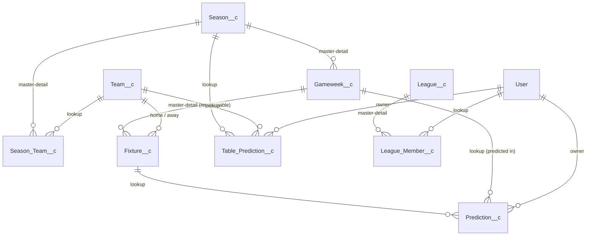

# Data model

See [game-rules.md](game-rules.md) for the rules this model supports.

## Reference data

Filled by the fixture sync (or by the admin as a fallback). Public Read Only.

### Season\_\_c

| Field                          | Type                 | Notes                                                    |
| ------------------------------ | -------------------- | -------------------------------------------------------- |
| Name                           | Text                 | `2026/27`                                                |
| Status\_\_c                    | Picklist             | Upcoming / Active / Finished                             |
| Start_Date\_\_c, End_Date\_\_c | Date                 |                                                          |
| Table_Prediction_Deadline\_\_c | DateTime             | Normally first kickoff − 1h; for 2026/27 the launch date |
| External_Id\_\_c               | Text, unique, ext ID | API season ID                                            |

### Team\_\_c

| Field            | Type                 | Notes                  |
| ---------------- | -------------------- | ---------------------- |
| Name             | Text                 | Arsenal                |
| Short_Name\_\_c  | Text(3)              | ARS                    |
| Crest_URL\_\_c   | URL                  | Badge image for the UI |
| External_Id\_\_c | Text, unique, ext ID | API team ID            |

Teams aren't tied to a season, so a club can be relegated and come back.

### Season_Team\_\_c

Which 20 teams play in a season, and the league table.

| Field                    | Type          | Notes                                                         |
| ------------------------ | ------------- | ------------------------------------------------------------- |
| Season\_\_c              | Master-Detail |                                                               |
| Team\_\_c                | Lookup        |                                                               |
| Position\_\_c            | Number        | Live position; the final position once the Season is Finished |
| Points\_\_c, Played\_\_c | Number        | For displaying the table                                      |
| Unique_Key\_\_c          | Text, unique  | `SeasonId-TeamId`                                             |

### Gameweek\_\_c

| Field              | Type                                | Notes                                                                                                                                                            |
| ------------------ | ----------------------------------- | ---------------------------------------------------------------------------------------------------------------------------------------------------------------- |
| Season\_\_c        | Master-Detail                       |                                                                                                                                                                  |
| Number\_\_c        | Number                              | 1–38                                                                                                                                                             |
| First_Kickoff\_\_c | Roll-up MIN of Fixture `Kickoff__c` | Filter: Status ≠ Postponed                                                                                                                                       |
| Deadline\_\_c      | Formula (DateTime)                  | `First_Kickoff__c - 1/24` (one hour before)                                                                                                                      |
| Locked\_\_c        | Checkbox                            | Sticky lock set by the sync once the deadline has passed; can't be cleared (validation rule). Predictions are locked when `Locked__c` OR the deadline has passed |
| Unique_Key\_\_c    | Text, unique                        | `SeasonId-Number`                                                                                                                                                |

### Fixture\_\_c

| Field                            | Type                               | Notes                                       |
| -------------------------------- | ---------------------------------- | ------------------------------------------- |
| Gameweek\_\_c                    | Master-Detail, reparenting allowed | Moves when a postponed match is rescheduled |
| Home_Team\_\_c, Away_Team\_\_c   | Lookup → Team                      |                                             |
| Kickoff\_\_c                     | DateTime                           |                                             |
| Status\_\_c                      | Picklist                           | Scheduled / Live / Finished / Postponed     |
| Home_Goals\_\_c, Away_Goals\_\_c | Number                             | Final score                                 |
| External_Id\_\_c                 | Text, unique, ext ID               | API match ID                                |

**Sync note:** in the Premier League a rescheduled match usually keeps its original matchday number in the API. The sync must assign it to a gameweek by its **new kickoff date**, not by the API matchday.

## Player data

Private OWD: the record **Owner is the player**, so standard sharing hides other players' predictions. Friends' predictions after the deadline are returned by a dedicated Apex method that checks the deadline.

### Prediction\_\_c

| Field                            | Type         | Notes                                                                     |
| -------------------------------- | ------------ | ------------------------------------------------------------------------- |
| Owner                            | User         | The player                                                                |
| Fixture\_\_c                     | Lookup       |                                                                           |
| Gameweek\_\_c                    | Lookup       | Gameweek it was predicted in; does **not** follow the fixture if it moves |
| Home_Goals\_\_c, Away_Goals\_\_c | Number       | Predicted score                                                           |
| Status\_\_c                      | Picklist     | Open / Scored / Voided                                                    |
| Points\_\_c                      | Number       | 0, 3 or 8                                                                 |
| Exact_Score\_\_c                 | Checkbox     | Used for the tie-breaker                                                  |
| Unique_Key\_\_c                  | Text, unique | `OwnerId-FixtureId-GameweekId`, set by trigger                            |

**Postponement:** when a fixture is postponed, its predictions become Voided with 0 points. When it's rescheduled into a later gameweek, players predict it again. The new prediction has a different Gameweek, so the unique key allows it.

### Table_Prediction\_\_c

20 records per player per season.

| Field                   | Type         | Notes                                           |
| ----------------------- | ------------ | ----------------------------------------------- |
| Owner                   | User         | The player                                      |
| Season\_\_c, Team\_\_c  | Lookup       |                                                 |
| Predicted_Position\_\_c | Number       | 1–20                                            |
| Points\_\_c             | Number       | 20 / 15 / 10 / 5 / 0                            |
| Team_Key\_\_c           | Text, unique | `OwnerId-SeasonId-TeamId`: each team once       |
| Position_Key\_\_c       | Text, unique | `OwnerId-SeasonId-Position`: each position once |

## Leagues

Public Read Only.

### League\_\_c

| Field            | Type      | Notes                     |
| ---------------- | --------- | ------------------------- |
| Name             | Text      |                           |
| Description\_\_c | Text Area |                           |
| Owner            | User      | The league's commissioner |

Leagues continue across seasons; standings are per season.

### League_Member\_\_c

| Field            | Type          | Notes                                    |
| ---------------- | ------------- | ---------------------------------------- |
| League\_\_c      | Master-Detail |                                          |
| User\_\_c        | Lookup → User | Required via validation rule (see below) |
| Joined_Date\_\_c | Date          |                                          |
| Unique_Key\_\_c  | Text, unique  | `LeagueId-UserId`                        |

## Leaderboards

Leaderboards aren't stored. They're calculated on demand: the sum of each league member's `Prediction__c.Points__c` and `Table_Prediction__c.Points__c` for the season (aggregate SOQL). The data volume is tiny (about 4 players × 380 matches), and there are no stored totals to keep in sync.

## Design decisions

1. **Owner = player** instead of a `Player__c` lookup, so Private OWD plus standard sharing protects predictions before the deadline. (A master-detail to Fixture would inherit the Fixture's public read access.)
2. **Unique keys set by trigger handlers.** Salesforce has no composite unique constraint; a unique text field filled by the handler enforces "one per …" at database level.
3. **Gameweek deadline is declarative:** a roll-up (MIN kickoff, excluding postponed) plus a formula, so no code is needed.
4. **Org-wide defaults:** reference data and leagues are Public Read Only; Prediction and Table Prediction are Private. The same applies to external (site) users.
5. **Leaderboards are computed, not stored** (see above).
6. **Lookup to User can't be required in metadata**, so `League_Member__c.User__c` is optional with the `User_Required` validation rule.

## Validation rules

| Object                | Rule                    | Prevents                                  |
| --------------------- | ----------------------- | ----------------------------------------- |
| Fixture\_\_c          | Teams_Must_Differ       | A team playing itself                     |
| Fixture\_\_c          | Finished_Requires_Score | A Finished match without both goal fields |
| Prediction\_\_c       | Goals_Not_Negative      | Negative predicted goals                  |
| Table_Prediction\_\_c | Position_In_Range       | A predicted position outside 1–20         |
| League_Member\_\_c    | User_Required           | A membership without a player             |
| Gameweek\_\_c         | Locked_Stays_Locked     | Unlocking a locked gameweek               |

## Access

| Permission set   | Who           | Access                                                                           |
| ---------------- | ------------- | -------------------------------------------------------------------------------- |
| ScoreCall_Admin  | Product owner | Full access to all objects                                                       |
| ScoreCall_Player | Every player  | Read reference data and leagues; create/edit own Prediction and Table Prediction |
